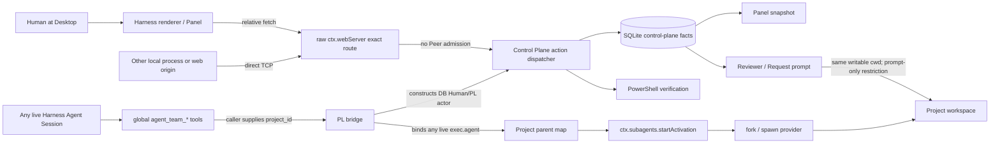
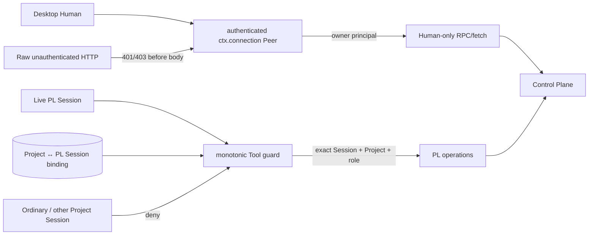

# R0 trust boundary

Scope: Agent Team Control Plane `0.6.0` on DeepSeek Harness Desktop
`0.2.1-rc.2`. This document describes the observed boundary, not the intended
one. Findings are reproduced in `docs/evidence/r0/r0-evidence.redacted.json`.

## Current data and control flow

Dashed or implied trust is deliberately not shown: a caller-supplied
`actor`, `project_id`, prompt assertion, `fork`/`spawn` name, or installed CLI
does not authenticate a person, Project, model, or Provider.

## Boundary inventory

### 1. Human, renderer and HTTP

- The Electron `dsh-app://app` forwarder is a trusted transport path: it checks
  its renderer Origin, removes caller Host/Origin/Cookie values, and injects the
  Host browser Cookie.
- The plugin registers a separate exact `ctx.webServer` route. In the installed
  Host, named routes run before the authenticated fallback. Direct TCP requests
  therefore bypass the renderer forwarder and connection admission.
- Current `GET` returns the complete control-plane snapshot before any identity
  check. Current `POST` parses the body and dispatches actions without an
  admitted principal. Body `{ actor: { type, id } }` is data, not identity.
- CORS response headers are absent, but CORS is not authorization. The server
  accepted a cross-origin `text/plain` request and reached action dispatch.
  Browser PNA/LNA behavior was not claimed or relied on; same-machine
  unauthenticated access is already proven.

**Assets crossing this boundary:** Project metadata, Charter and interview
facts, Agent/Task/Run/Result/Evidence/Review/Finding/Decision/Activity records,
runtime authorization, state-changing Human actions, and verification commands.

**Current verdict:** untrusted to trusted with no server-side admission.

### 2. Authenticated Host connection capability

The installed `@deepseek-ai/dsh-client-connection@0.2.1-rc.2` provides the
boundary the plugin currently omits:

- authority-bound signed Cookie authentication;
- Host, Origin and `Sec-Fetch-Site` validation;
- `ctx.connection.admit(request)` and authenticated RPC/fetch handlers;
- a live `Peer` whose browser principal is the owner.

This service distinguishes the authenticated local owner; R0 did not find a
public stable per-person identifier. R1 should use a single-owner identity
model unless a stronger Host identity is verified.

### 3. Host Tool execution

`ctx.tools` supplies a trusted live `exec.agent`, and the Agent/Session ID can be
checked against the Host Agent registry. That proves which Agent Session caused
a Tool call. It does **not** prove:

- that the Session is a Project Lead;
- that it belongs to the supplied Project;
- that a Human approved the call;
- that the supplied Workspace belongs to that caller.

The seven `agent_team_*` definitions are globally registered. Official tool
semantics make global tools visible to inheriting Agent scopes unless a
restriction or guard denies them. The current bridge first binds any live
`exec.agent` to `args.project_id`, then obtains the target Project from SQLite
and creates an actor with its stored `ownerId` or `leadAgentId`. A safe in-memory
PoC demonstrated this with an ordinary Session and did not touch real Projects.

**Current verdict:** trusted causal Agent identity is incorrectly promoted to
Project/Human authority.

### 4. Project PL Session and model

The public Client API can create a Session and return its ID through
`openWorkspace`, and can select an existing one through `openSession`. The
current client receives the new ID but stores no Project association. It always
requests the `standard` preset and does not prove that the Project's selected
PL runtime equals the Session route.

An isolated current-Host probe completed two turns in one retained Session. Its
redacted internal projection reported `deepseek-official/deepseek-flash` with
high reasoning. This proves only that probe Session. It does not authenticate a
Project binding or make the internal projection a supported API.

**Current verdict:** Host Session identity exists; Project binding and requested
versus actual model consistency do not.

### 5. Subagent Provider and workspace

- `ctx.subagents.startActivation()` is the correct installed orchestration API.
- The production profile registered `fork` and `spawn`, both continuation
  backends. Those names describe launch/provider behavior, not a model.
- The Host did not report their concrete child model, so it is `UNKNOWN`.
- Historical production records contain three successful managed `fork` runs.
  Fresh R0 tests separately proved a Codex external Provider could complete,
  abort, and be denied an outside-workspace write in an isolated profile, but
  that used the Provider's direct `start` path. Production did not register
  Codex or Claude Code during the R0 snapshot.
- A live parent check (`registry.get(parent.id) === parent`) prevents fabricated
  Agent objects, but the current Project parent map does not verify that the
  Agent is the Project's authorised PL.

**Current verdict:** activation API and live-Agent check are real; Project
authorization and actual child model identity are missing.

### 6. Reviewer / Request Agent and filesystem

Reviewer and one-shot Request prompts say not to modify files, but the activation
receives the real Project workspace as `cwd`. No read-only sandbox, restricted
Tool scope, or command denial is selected by governance. A prompt is content,
not enforcement. The isolated Codex sandbox result cannot be generalized to
`fork`, `spawn`, Reviewer, or Request runs.

**Current verdict:** no preventative read-only boundary. R2 must prefer a
Host-enforced read-only execution environment. A pre/post filesystem diff is a
useful detection fallback but cannot undo a side effect.

### 7. Skills

The current Host scan completed successfully, reported
`grillMeAvailable=false`, and found only `diagnose-windows-sandbox-acl`. A Skill
name in a directory or discovery snapshot would still not prove invocation; an
actual Session invocation/event would be required.

**Current verdict:** `grill-me` was neither available nor executed. The existing
deterministic interview is the only verified fallback.

## Required R1 boundary

R1 acceptance must fail closed:

1. authenticate both reads and writes before reading the body or snapshot;
2. derive Human authority from the admitted owner `Peer`, not body fields;
3. bind one verified PL Session to one Project and check it for every Tool call;
4. deny ordinary, cross-Project, stale, missing-Agent and replaced-PL Sessions
   without creating a parent binding or other side effect;
5. keep Tool visibility restrictions as defence in depth, with a server-side
   authorization guard as the authority;
6. stop `record_interview` from manufacturing a Human confirmation; record a PL
   proposal and require an authenticated Human approval;
7. if authenticated Host RPC cannot be composed, expose only a read-only Panel
   and disable sensitive HTTP/PL operations until Human approves a documented
   constrained mode. Loopback alone is not a fallback identity.

## Data deliberately excluded from R0 evidence

No launch token, signed Cookie, Authorization value, credential file, API key,
full control-plane snapshot, actual Project content, full prompt/response, or
complete reasoning trace is stored in this repository. Session IDs and runtime
record identifiers are redacted. Response bodies were classified or hashed
without being copied into the evidence bundle.
